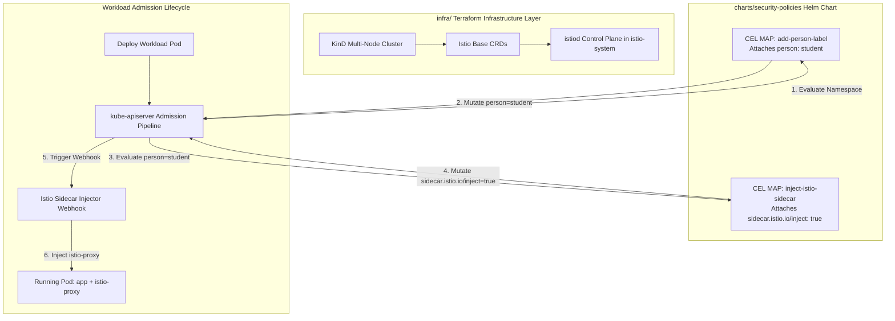

# Module 04 – Service Mesh (Istio Sidecar with Native CEL MutatingAdmissionPolicy)

This guide walks you through setting up and operating the **Istio Service Mesh** in **Sidecar Mode** on the production platform. The core service mesh control plane is provisioned as decoupled platform infrastructure via Terraform in `infra/`, while automatic sidecar injection is orchestrated natively using Kubernetes **Common Expression Language (CEL) MutatingAdmissionPolicy** in `charts/security-policies/`.

---

## Architecture Overview

Module 04 implements a high-efficiency service mesh architecture with zero external admission controller overhead:

1. **Infrastructure Layer (`infra/`)**:
   - Provisions the Istio Base definitions (CRDs, ClusterRoles) and Istio Control Plane (`istiod`) directly in the `istio-system` namespace.
   - Configures mesh defaults with auto-mTLS (`enableAutoMtls: true`) and stdout access logging (`accessLogFile: /dev/stdout`).
   - Remains strictly decoupled from application manifests and tenant release lifecycles.

2. **Native Admission Policy Layer (`charts/security-policies/`)**:
   - Evaluates admission rules natively within `kube-apiserver` using Kubernetes CEL.
   - Chains the `add-person-label` mutating policy (assigning `person: student`) with the `inject-istio-sidecar` mutating policy (mutating `sidecar.istio.io/inject: "true"`).
   - Utilizes `reinvocationPolicy: IfNeeded` to guarantee automatic sidecar injection enablement even when person labels are applied during the same admission evaluation cycle.

3. **Istio Mutating Webhook**:
   - Intercepts pods labeled with `sidecar.istio.io/inject: "true"` and injects the `istio-proxy` sidecar container (resulting in `2/2` ready containers per pod).



---

## Key Design Principles

| Principle | Implementation Details |
|---|---|
| **Zero Controller Overhead** | Automatic injection uses native in-tree Kubernetes CEL (`MutatingAdmissionPolicy`), eliminating the need for third-party policy engines like Kyverno. |
| **Strict Layer Separation** | `infra/` provisions only core control plane primitives (`istio-base` and `istiod`). Applications and policies reside in their respective layers. |
| **Transparent Sidecar Enablement** | Application developers do not need to modify deployment manifests; student pods transparently receive mesh proxies upon admission. |
| **mTLS by Default** | Strict mutual TLS is enabled across all mesh workloads automatically. |

---

## Step 1: Provision Infrastructure & Istio Control Plane

1. Navigate to the `infra/` directory:
   ```bash
   cd infra
   ```

2. Initialize Terraform:
   ```bash
   terraform init
   ```

3. Apply the infrastructure:
   ```bash
   terraform apply
   ```

4. Verify that `istiod` is running in `istio-system`:
   ```bash
   export KUBECONFIG="$(pwd)/k8s-in-production-config"
   kubectl get pods -n istio-system
   ```

---

## Step 2: Deploy Security Policies with Sidecar Injection Rule

The security policies chart includes the native CEL mutating policy:

```yaml
# charts/security-policies/templates/policy-istio-sidecar.yaml
apiVersion: admissionregistration.k8s.io/v1beta1
kind: MutatingAdmissionPolicy
metadata:
  name: inject-istio-sidecar
spec:
  failurePolicy: Fail
  reinvocationPolicy: IfNeeded
  matchConstraints:
    resourceRules:
      - apiGroups: [""]
        apiVersions: ["v1"]
        operations: ["CREATE", "UPDATE"]
        resources: ["pods"]
  matchConditions:
    - name: has-student-person-label
      expression: >-
        has(object.metadata.labels) &&
        has(object.metadata.labels.person) &&
        (object.metadata.labels.person == "student" || object.metadata.labels.person.startsWith("student"))
  mutations:
    - patchType: ApplyConfiguration
      applyConfiguration:
        expression: >-
          Object{metadata: Object.metadata{labels: {"sidecar.istio.io/inject": "true"}}}
```

Deploy or upgrade via Helm:
```bash
helm upgrade --install security-policies charts/security-policies -n flux-system
```

---

## Step 3: Automated Verification

Run the end-to-end verification suite using `mise`:

```bash
mise run test:module04
```

Or execute the test script directly:

```bash
bash tests/verify-module04.sh
```

### What the Test Validates:
1. **Cluster Accessibility**: Verifies multi-node KinD cluster status.
2. **Control Plane Health**: Confirms `istio-system` namespace, `istiod` readiness, and active `istio-sidecar-injector` mutating webhook.
3. **Admission Policy Registration**: Checks `inject-istio-sidecar` `MutatingAdmissionPolicy` and `MutatingAdmissionPolicyBinding`.
4. **Student Workload Injection**: Deploys a pod in `student01`, checks `person: student` label assignment, validates `sidecar.istio.io/inject: "true"` mutation, and verifies `istio-proxy` injection.
5. **Non-Student Exemption**: Deploys a pod in `mentor` and confirms that no sidecar is injected.

---

## Teardown

To clean up test resources and destroy the local infrastructure:

```bash
cd infra
terraform destroy -auto-approve
```
