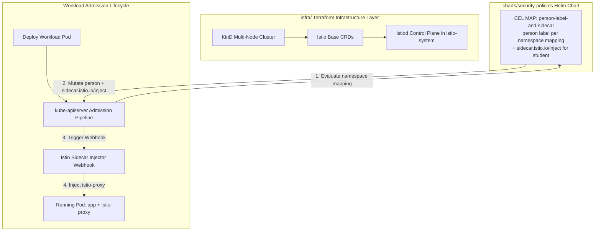

# Module 04 – Service Mesh (Istio Sidecar with Native CEL MutatingAdmissionPolicy)

This guide walks you through setting up and operating the **Istio Service Mesh** in **Sidecar Mode** on the production platform. The core service mesh control plane is provisioned as decoupled platform infrastructure via Terraform in `infra/`, while automatic sidecar injection is orchestrated natively using Kubernetes **Common Expression Language (CEL) MutatingAdmissionPolicy** in `charts/security-policies/`.

---

## Architecture Overview

Module 04 implements a high-efficiency service mesh architecture with zero external admission controller overhead:

1. **Infrastructure Layer (`infra/`)**:
   - Provisions the Istio Base definitions (CRDs, ClusterRoles) and Istio Control Plane (`istiod`) directly in the `istio-system` namespace.
   - Configures mesh defaults with auto-mTLS (`enableAutoMtls: true`) and stdout access logging (`accessLogFile: /dev/stdout`).
   - Remains strictly decoupled from application manifests and tenant release lifecycles.

2. **Native Admission Policy Layer (`charts/security-policies/`)**:
   - Evaluates admission rules natively within `kube-apiserver` using Kubernetes CEL.
   - A single `person-label-and-sidecar` mutating policy decides, from one namespace mapping (`policies.personLabel.mappings`), both the `person` label and the sidecar enablement label (`sidecar.istio.io/inject: "true"`).
   - Namespaces in a mapping get `person=<labelValue>`; in every other namespace the `person` label is removed, even if a pod brings its own.
   - Sidecar enablement is set only for mappings with `injectSidecar: true` (the `student` mapping), so it is always consistent with `person: student`.
   - **Why one policy:** several `MutatingAdmissionPolicy` objects have no documented evaluation order, and `reinvocationPolicy: IfNeeded` did not reliably re-run a policy after a sibling policy added a label. Two chained policies (`add-person-label` then `inject-istio-sidecar`) therefore left pods without a sidecar. All mutations of one policy are evaluated against the incoming object, so the sidecar mutation reads the shared `variables`, never the label another policy may or may not have added yet.

3. **Istio Mutating Webhook**:
   - Intercepts pods labeled with `sidecar.istio.io/inject: "true"` and injects the `istio-proxy` sidecar container (resulting in `2/2` ready containers per pod).



---

## Key Design Principles

| Principle | Implementation Details |
|---|---|
| **Zero Controller Overhead** | Automatic injection uses native in-tree Kubernetes CEL (`MutatingAdmissionPolicy`), eliminating the need for third-party policy engines like Kyverno. |
| **Strict Layer Separation** | `infra/` provisions only core control plane primitives (`istio-base` and `istiod`). Applications and policies reside in their respective layers. |
| **Transparent Sidecar Enablement** | Application developers do not need to modify deployment manifests; student pods transparently receive mesh proxies upon admission. |
| **mTLS by Default** | Strict mutual TLS is enabled across all mesh workloads automatically. |

---

## Step 1: Provision Infrastructure & Istio Control Plane

1. Navigate to the `infra/` directory:
   ```bash
   cd infra
   ```

2. Initialize Terraform:
   ```bash
   terraform init
   ```

3. Apply the infrastructure:
   ```bash
   terraform apply
   ```

4. Verify that `istiod` is running in `istio-system`:
   ```bash
   export KUBECONFIG="$(pwd)/k8s-in-production-config"
   kubectl get pods -n istio-system
   ```

---

## Step 2: Deploy Security Policies with Sidecar Injection Rule

The security policies chart (`charts/security-policies/templates/policy-person-label-and-sidecar.yaml`) renders one native CEL mutating policy from `values.yaml`:

```yaml
policies:
  personLabel:
    mappings:
      - labelValue: student
        injectSidecar: true
        namespaces: [student01, student02, student03]
      - labelValue: mentor
        injectSidecar: false
        namespaces: [mentor]
```

```yaml
# rendered MutatingAdmissionPolicy (abridged)
variables:
  - name: person
    expression: request.namespace in ["student01","student02","student03"] ? "student" : request.namespace in ["mentor"] ? "mentor" : ""
  - name: injectSidecar
    expression: request.namespace in ["student01","student02","student03"] ? true : request.namespace in ["mentor"] ? false : false
mutations:
  - patchType: ApplyConfiguration   # set person
    applyConfiguration:
      expression: 'variables.person != "" ? Object{metadata: Object.metadata{labels: {"person": variables.person}}} : Object{}'
  - patchType: ApplyConfiguration   # enable sidecar injection
    applyConfiguration:
      expression: 'variables.injectSidecar ? Object{metadata: Object.metadata{labels: {"sidecar.istio.io/inject": "true"}}} : Object{}'
  - patchType: JSONPatch            # no person label outside the mapping
    jsonPatch:
      expression: 'variables.person == "" && has(object.metadata.labels) && "person" in object.metadata.labels ? [JSONPatch{op: "remove", path: "/metadata/labels/person"}] : []'
```

Deploy or upgrade via Helm:
```bash
helm upgrade --install security-policies charts/security-policies -n flux-system
```

---

## Step 3: Automated Verification

Run the end-to-end verification suite using `mise`:

```bash
mise run test:module04
```

Or execute the test script directly:

```bash
bash tests/verify-module04.sh
```

### What the Test Validates:
1. **Cluster Accessibility**: Verifies multi-node KinD cluster status.
2. **Control Plane Health**: Confirms `istio-system` namespace, `istiod` readiness, and active `istio-sidecar-injector` mutating webhook.
3. **Admission Policy Registration**: Checks the `person-label-and-sidecar` `MutatingAdmissionPolicy` and binding, and that the legacy `add-person-label` / `inject-istio-sidecar` policies are gone.
4. **Student Workload Injection**: Deploys a pod in `student01`, checks `person: student` label assignment, validates `sidecar.istio.io/inject: "true"` mutation, and verifies `istio-proxy` injection.
5. **Non-Student Exemption**: Deploys a pod in `mentor`, confirms `person=mentor` and that no sidecar is injected.
6. **Other Namespaces**: Deploys a pod in `default` that brings `person: student` and confirms the label is removed (other labels kept) and no sidecar is injected.

---

## Teardown

To clean up test resources and destroy the local infrastructure:

```bash
cd infra
terraform destroy -auto-approve
```
