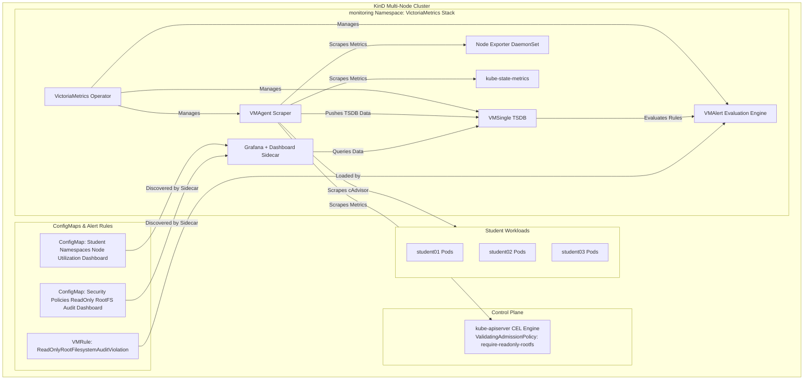

# Module 05 – Observability & Troubleshooting (VictoriaMetrics Monitoring Stack)

This guide walks you through setting up and operating the **VictoriaMetrics Observability Stack** on the Kubernetes production platform. The complete monitoring subsystem is provisioned declaratively via Terraform in `infra/monitoring.tf` using the official `victoria-metrics-k8s-stack` Helm chart (pinned to version `0.96.0`), while tenant node resource utilization tracking and native CEL admission audit alerting are managed via GitOps Grafana ConfigMaps and `VMRule` custom resources.

---

## Architecture Overview

Module 05 implements a lightweight, high-performance monitoring and security auditing architecture designed for multi-node Kubernetes clusters:

1. **Infrastructure & TSDB Layer (`infra/monitoring.tf`)**:
   - Deploys `victoria-metrics-k8s-stack` into the `monitoring` namespace.
   - Provisions VictoriaMetrics Operator, `VMSingle` (time-series database), `VMAgent` (metric collection & scrape controller), `VMAlert` (alert evaluation engine), and `Alertmanager`.
   - Provisions `node-exporter` (node-level metrics) and `kube-state-metrics` (cluster object metadata).
   - Scrapes native `kube-apiserver` admission metrics for Common Expression Language (CEL) policy enforcement evaluations.

2. **GitOps Dashboard Layer (`charts/security-policies/templates/`)**:
   - **Student Namespaces Node Utilization Dashboard**: Tracks CPU core rate, memory working set, and pod allocation across cluster nodes partitioned by student namespaces (`student01`, `student02`, `student03`).
   - **Security Policies ReadOnly RootFS Audit Dashboard**: Visualizes admission policy audit evaluations, violation rates, and active alert firing states in real-time.
   - Loaded automatically by the Grafana dashboard sidecar (`k8s-sidecar`) watching ConfigMaps labeled with `grafana_dashboard: "1"`.

3. **CEL Admission Policy Auditing & VMAlert (`VMRule`)**:
   - Evaluates `ReadOnlyRootFilesystemAuditViolation` using MetricsQL whenever a pod is admitted in `Audit` mode with writeable root filesystem.



---

## Key Design Principles

| Principle | Implementation Details |
|---|---|
| **MetricsQL-Driven Policy Auditing** | Detects read-only rootfs audit events via native `kube-apiserver` metric `apiserver_validating_admission_policy_check_total` and `apiserver_admission_policy_admission_evaluations_total` with zero log-daemon overhead. |
| **Declarative Infrastructure** | Complete monitoring platform provisioned through Terraform (`infra/monitoring.tf`) with pinned stable version `0.96.0`. |
| **Hot-Reloaded GitOps Dashboards** | Grafana dashboard definitions stored as labeled ConfigMaps (`grafana_dashboard: "1"`) and hot-reloaded automatically by sidecars. |
| **Lean Resource Footprint** | Tuned resource requests and limits to ensure stability on local multi-node KinD environments. |

---

## MetricsQL Queries Reference

### 1. Student Workload Node Utilization
- **CPU Usage by Student Namespace across Nodes:**
  ```promql
  sum(rate(container_cpu_usage_seconds_total{namespace=~"student.*", container!=""}[5m])) by (node, namespace)
  ```
- **Memory Working Set by Student Namespace across Nodes:**
  ```promql
  sum(container_memory_working_set_bytes{namespace=~"student.*", container!=""}) by (node, namespace)
  ```
- **Active Student Workload Pods per Node:**
  ```promql
  count(kube_pod_info{namespace=~"student.*"}) by (node, namespace)
  ```

### 2. ReadOnly RootFS CEL Admission Policy Auditing
- **CEL Admission Audit Evaluation Rate:**
  ```promql
  increase(apiserver_validating_admission_policy_check_total{policy="require-readonly-rootfs", enforcement_action="audit"}[5m])
  ```
- **Active Alert Evaluation Expression (Immediate + Persistent while Pod Exists):**
  ```promql
  (increase(apiserver_validating_admission_policy_check_total{policy="require-readonly-rootfs", enforcement_action="audit"}[5m]) > 0)
  or ((apiserver_validating_admission_policy_check_total{policy="require-readonly-rootfs", enforcement_action="audit"} > 0) and on() (count(kube_pod_status_phase{namespace=~"student.*", phase="Running"}) > 0))
  ```
- **Active Alert Status:**
  ```promql
  count(ALERTS{alertname="ReadOnlyRootFilesystemAuditViolation", alertstate="firing"})
  ```

---

## Step-by-Step Operations

### 1. Provision Infrastructure & Monitoring Stack
1. Navigate to the `infra/` directory:
   ```bash
   cd infra
   ```
2. Apply Terraform configuration:
   ```bash
   terraform apply
   ```
3. Verify all monitoring components:
   ```bash
   kubectl get pods,vmsingle,vmagent,vmalert -n monitoring
   ```

### 2. Access Grafana UI & Dashboards
1. Retrieve the Grafana administrator password:
   ```bash
   kubectl get secret --namespace monitoring victoria-metrics-k8s-stack-grafana -o jsonpath="{.data.admin-password}" | base64 --decode ; echo
   ```
2. Port-forward the Grafana service:
   ```bash
   kubectl port-forward -n monitoring svc/victoria-metrics-k8s-stack-grafana 3000:80
   ```
3. Open `http://localhost:3000` in your browser and log in with username `admin`.
4. Navigate to **Dashboards** to view:
   - **Student Namespaces - Node Utilization** (`uid: student-node-utilization`)
   - **Security Policies - ReadOnly RootFS Audit** (`uid: readonly-rootfs-audit`)

### 3. Trigger CEL Admission Violation & Observe Alert
1. Deploy a non-compliant pod into `student01` with `readOnlyRootFilesystem: false`:
   ```bash
   cat <<EOF | kubectl apply -n student01 -f -
   apiVersion: v1
   kind: Pod
   metadata:
     name: audit-test-pod
     labels:
       person: student
   spec:
     containers:
       - name: app
         image: alpine:latest
         command: ["sh", "-c", "sleep 3600"]
         securityContext:
           readOnlyRootFilesystem: false
   EOF
   ```
2. Observe the Kubernetes API admission warning in your terminal:
   ```
   Warning: Validation failed for ValidatingAdmissionPolicy 'require-readonly-rootfs': Containers must use a read-only root filesystem.
   ```
3. View the active alert in VMAlert or on the Grafana **Security Policies - ReadOnly RootFS Audit** dashboard.

---

## Automated Verification

Run the end-to-end test suite via `mise`:

```bash
mise run test:module05
```

Or execute directly:

```bash
bash tests/verify-module05.sh
```

### What the Test Suite Validates:
1. **Cluster & Namespace Health**: Confirms cluster node availability and `monitoring` namespace presence.
2. **VictoriaMetrics Stack Health**: Verifies readiness of VictoriaMetrics Operator, VMSingle, VMAgent, VMAlert, Alertmanager, Grafana, Node Exporter, and kube-state-metrics.
3. **Dashboard Discovery**: Queries Grafana HTTP API to verify sidecar discovery of both custom dashboards.
4. **Metrics Ingestion**: Validates that VMSingle actively stores node and student pod metrics.
5. **CEL Admission Audit Alerting**: Deploys a violating pod, validates metric increments from `kube-apiserver`, confirms `ReadOnlyRootFilesystemAuditViolation` switches to `FIRING` in VMAlert, and cleans up the test workload.
